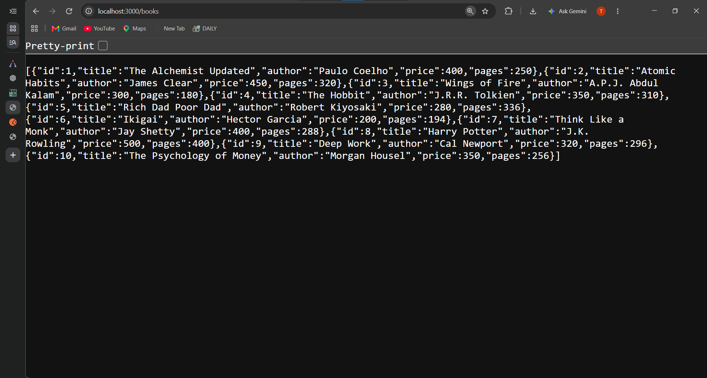
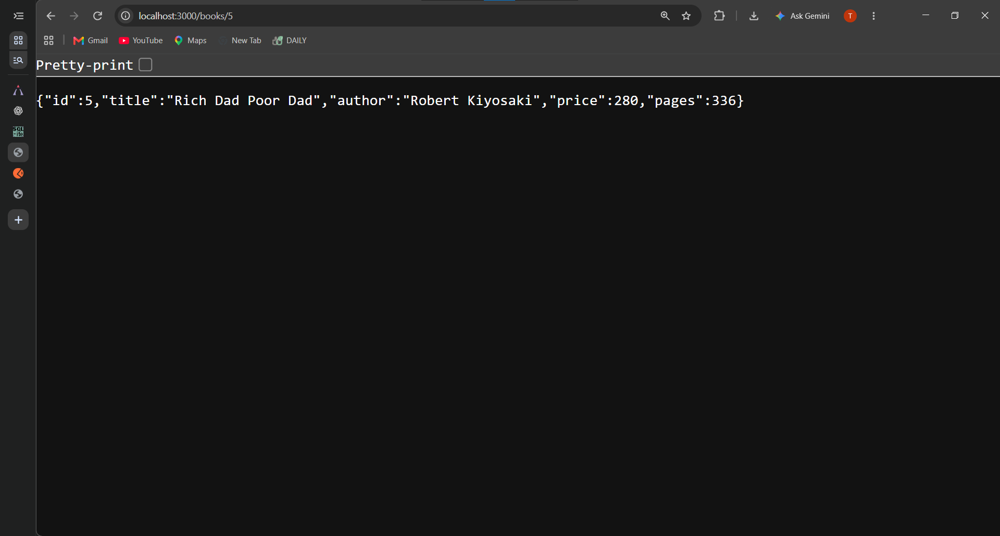
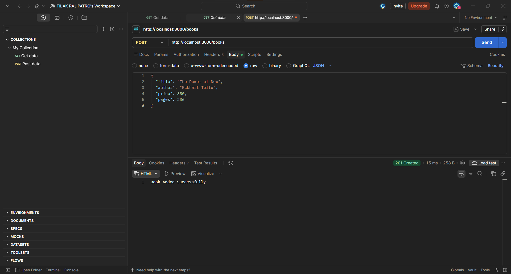
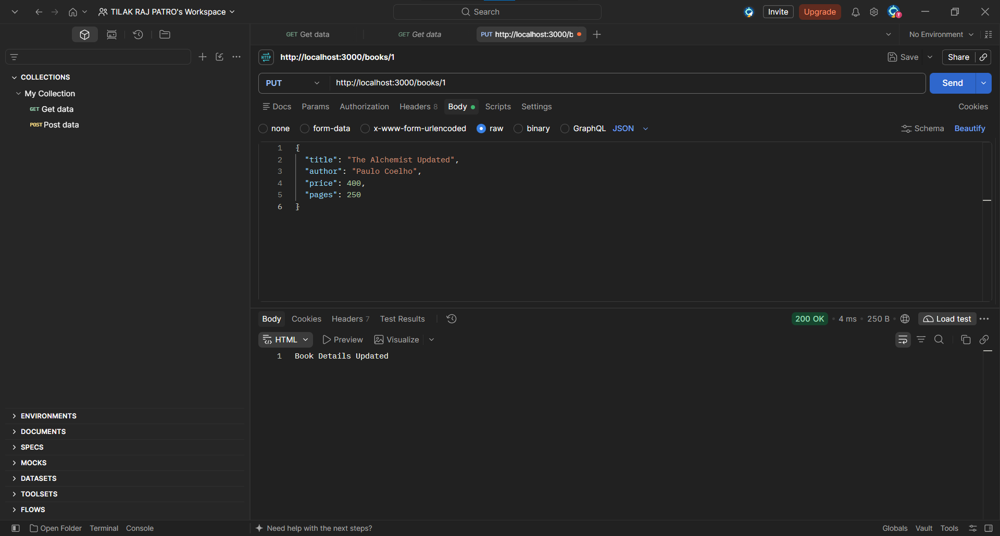
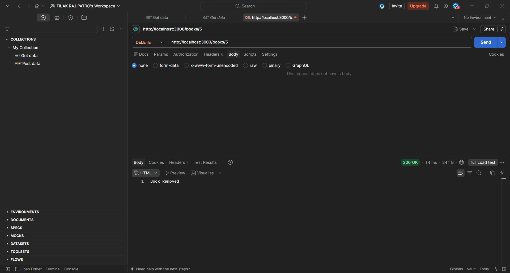
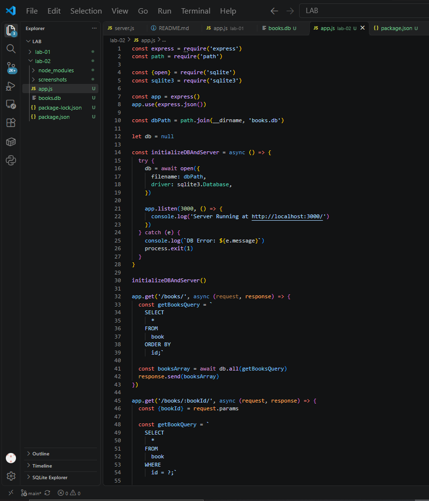
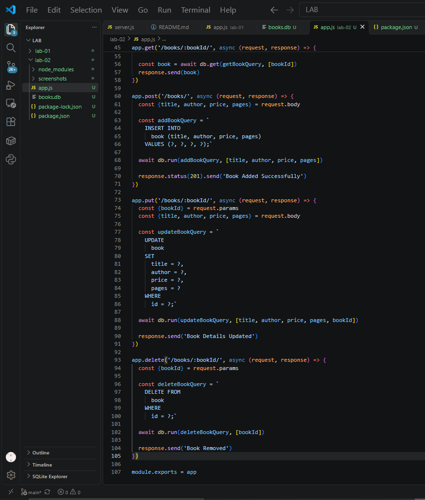

# Lab 2: SQLite Database and CRUD Routes

**Name:** Tilak Raj Patro  
**Registration Number:** 252U1R3096  
**Section:** CSE DS-2B

## Live Link

[Lab 2 - Live Deployment](https://backend-development-fundamentals-lab2.onrender.com)

## Objective

To connect an Express.js server with an SQLite database and implement CRUD operations using HTTP routes.

## Technologies Used

- Node.js
- Express.js
- SQLite
- SQLite3
- Nodemon
- Postman

## How to Run

**1. Clone the repository**

```bash
git clone https://github.com/rajtilak123/Backend-Development-Fundamentals-Labs.git
```

**2. Navigate to the Lab 2 folder**

```bash
cd Backend-Development-Fundamentals-Labs/lab-02
```

**3. Install dependencies**

```bash
npm install
```

**4. Start the development server**

```bash
npm run dev
```

The server runs at:

`http://localhost:3000/`

## Environment Variables

No environment variables are required.

## Database Structure

**Database:** `books.db`

**Table:** `book`

| Column | Data Type |
|---|---|
| id | INTEGER PRIMARY KEY |
| title | TEXT |
| author | TEXT |
| price | INTEGER |
| pages | INTEGER |

The database contains sample book records used to test the CRUD operations.

## API Endpoints

| Method | Endpoint | Description |
|---|---|---|
| GET | `/books/` | Retrieves all books |
| GET | `/books/:bookId/` | Retrieves a book by ID |
| POST | `/books/` | Adds a new book |
| PUT | `/books/:bookId/` | Updates book details |
| DELETE | `/books/:bookId/` | Deletes a book |

## Screenshots

### 1. GET All Books



### 2. GET Book by ID



### 3. POST - Add a Book



### 4. PUT - Update Book



### 5. DELETE - Remove a Book



## Code Screenshots





## Notes: Problems Faced and How I Solved Them

1. Initially, SQLite CLI was not installed on my system. I used the SQLite extension in VS Code to create and manage the database.
2. I faced an issue while running Nodemon because the terminal was in the parent directory. I solved it by navigating to the `lab-02` folder.
3. I received a 404 error while testing the PUT request. I checked the route implementation and corrected the issue.
4. I used parameterized SQL queries with `?` placeholders to safely pass user input into database queries.

## Conclusion

In this lab, I learned how to connect an Express.js application with an SQLite database and implement all five CRUD operations. I also practised testing API endpoints using Postman and verifying database changes.