# Lab 3: REST API, Query Parameters, Validation and Debugging

**Name:** Tilak Raj Patro\
**Registration Number:** 252U1R3096\
**Section:** CSE DS-2B

## Live Link

(https://backend-development-fundamentals-lab3.onrender.com)

## Objective

To improve the Lab 2 Books API by adding query parameters for searching,
sorting, pagination and price filtering, validating request data,
returning appropriate HTTP status codes, and testing API behaviour using
Postman.

## Technologies Used

-   Node.js
-   Express.js
-   SQLite
-   SQLite3
-   Nodemon
-   Postman

## How to Run

**1. Clone the repository**

``` bash
git clone https://github.com/rajtilak123/Backend-Development-Fundamentals-Labs.git
```

**2. Navigate to the Lab 3 folder**

``` bash
cd Backend-Development-Fundamentals-Labs/lab-03
```

**3. Install dependencies**

``` bash
npm install
```

**4. Start the development server**

``` bash
npm run dev
```

The server runs at:

`http://localhost:3000/`

## Environment Variables

The application uses `PORT` if it is provided. Otherwise, it runs on
port `3000` by default.

## Database Structure

**Database:** `books.db`

**Table:** `book`

  Column   Data Type
  -------- ---------------------
  id       INTEGER PRIMARY KEY
  title    TEXT
  author   TEXT
  price    INTEGER
  pages    INTEGER

## API Endpoints

  -----------------------------------------------------------------------
  Method                  Endpoint                Description
  ----------------------- ----------------------- -----------------------
  GET                     `/books/`               Retrieves books with
                                                  search, sorting,
                                                  pagination and
                                                  price-range filters

  GET                     `/books/:bookId/`       Retrieves a specific
                                                  book using its ID

  POST                    `/books/`               Adds a new book after
                                                  validating the request
                                                  body

  PUT                     `/books/:bookId/`       Updates the details of
                                                  an existing book

  DELETE                  `/books/:bookId/`       Deletes a book using
                                                  its ID
  -----------------------------------------------------------------------

### GET /books/ Query Parameters

  Query Parameter   Description
  ----------------- ---------------------------------------------------------
  `search_q`        Searches books by partial title
  `order_by`        Selects the column used for sorting
  `order`           Sorts in ascending (`ASC`) or descending (`DESC`) order
  `limit`           Sets the maximum number of books returned
  `offset`          Sets the number of records to skip
  `min_price`       Returns books at or above the minimum price
  `max_price`       Returns books at or below the maximum price

## HTTP Status Codes Tested

  Status Code   Meaning       Usage in this lab
  ------------- ------------- -----------------------------------------------
  200           OK            Successful GET, PUT and DELETE requests
  201           Created       Book added successfully
  400           Bad Request   Invalid query parameters or invalid book data
  404           Not Found     Requested book ID does not exist

## Screenshots

### 1. GET All Books

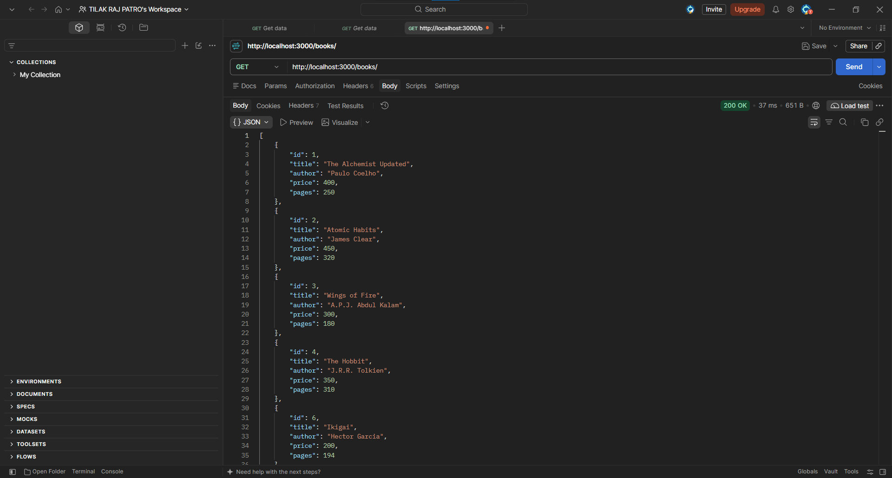

### 2. GET Books with Search, Sorting and Pagination

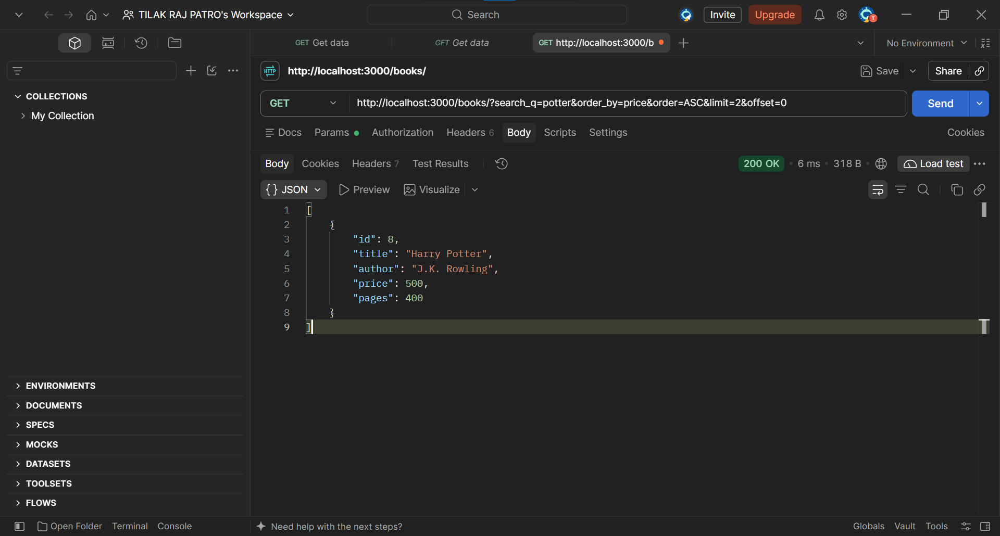

### 3. GET Books by Price Range

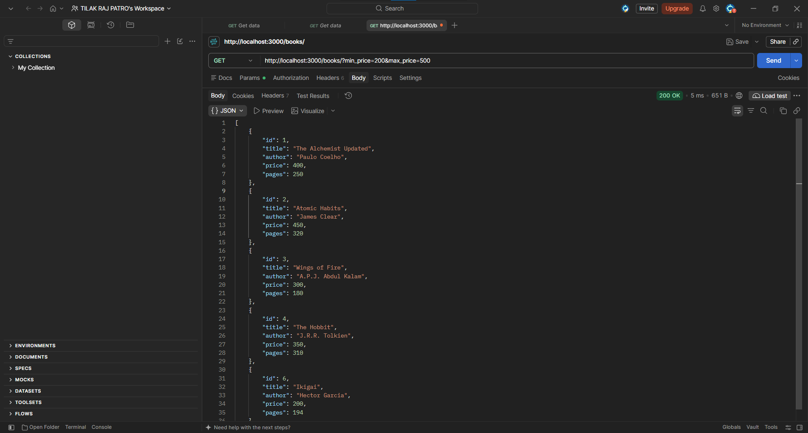

### 4. GET Books with Invalid Query Parameters

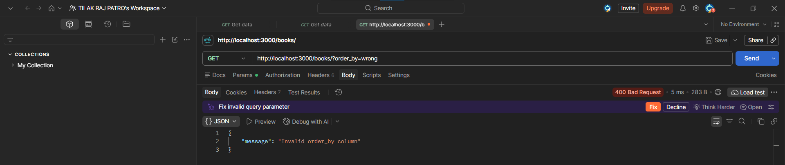

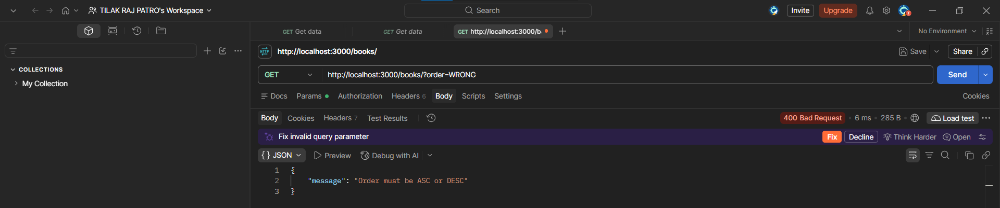

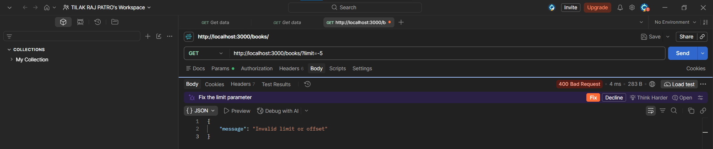

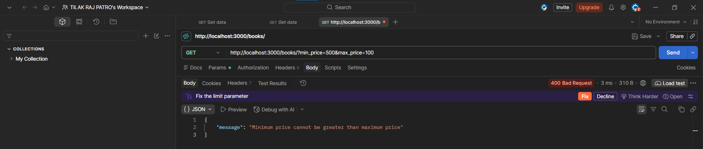

### 5. GET Book by ID

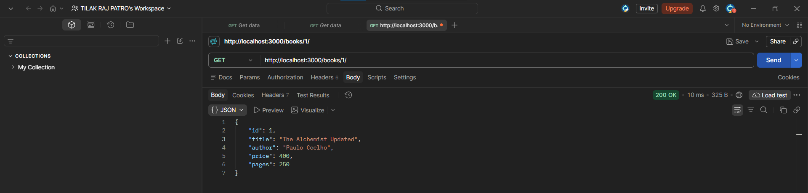

### 6. GET a Book ID That Does Not Exist

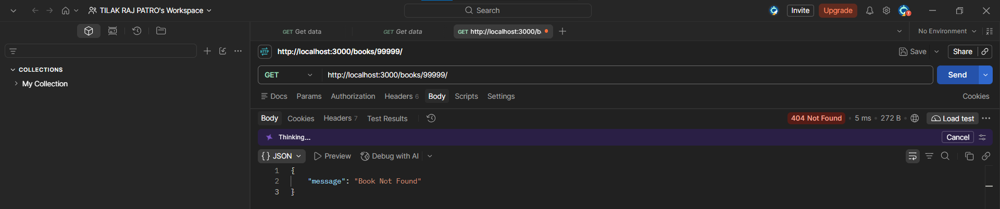

### 7. POST - Add a Book

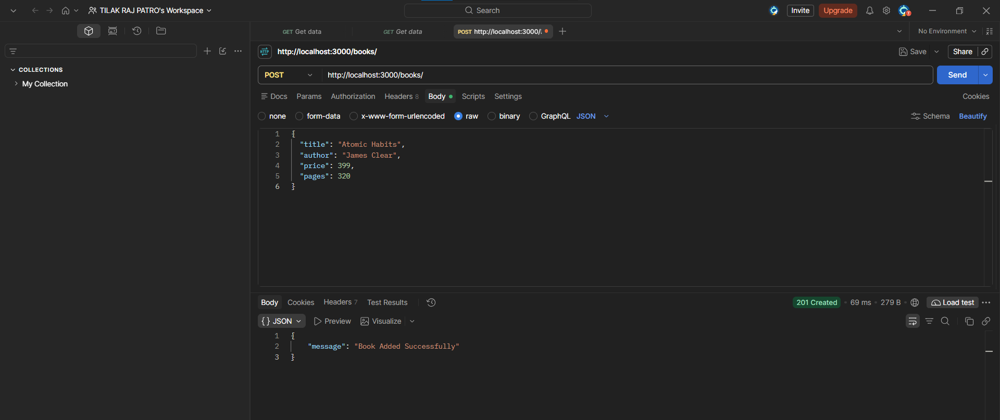

### 8. POST - Validate Book Data

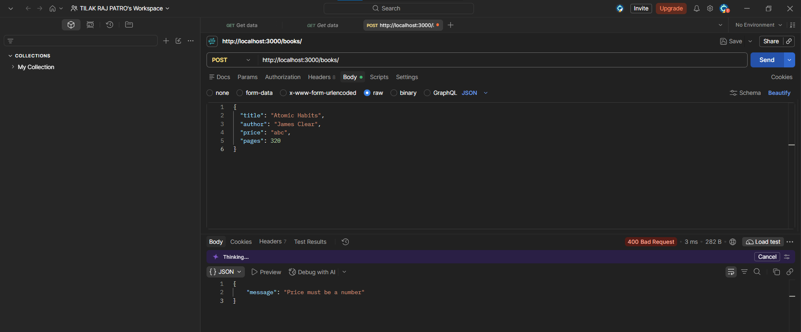

### 9. PUT - Update a Book

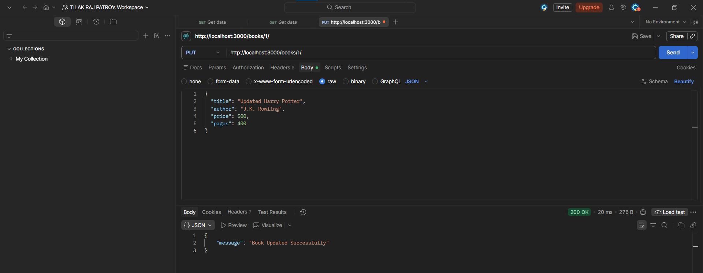

### 10. PUT - Update a Book ID That Does Not Exist

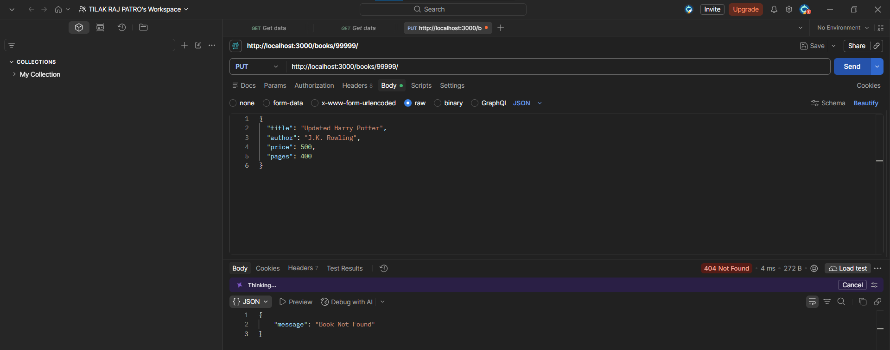

### 11. DELETE - Remove a Book

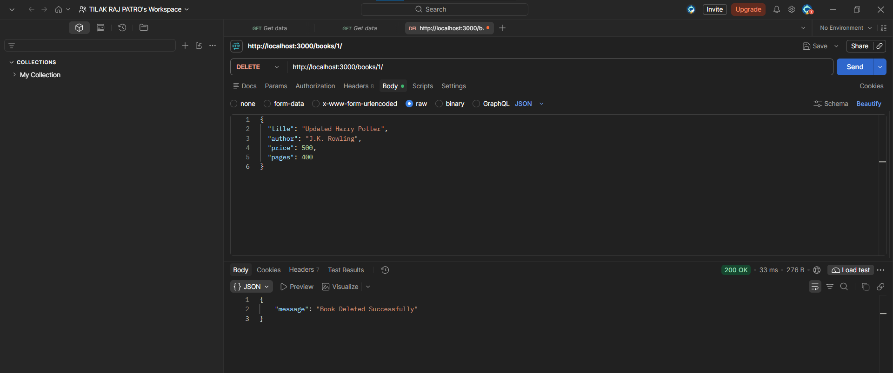

### 12. DELETE - Remove a Book ID That Does Not Exist

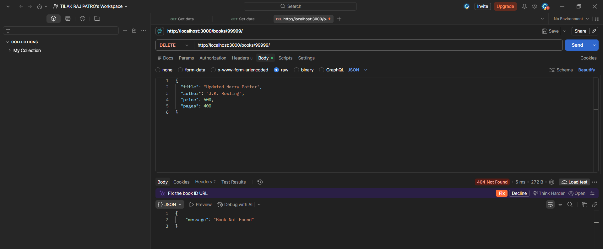

## Notes: Problems Faced and How I Solved Them

1.  While adding query parameters, I had to make sure that the URL used
    `?` before the first parameter and `&` between additional
    parameters.
2.  I added validation for sorting columns, sorting order, limit, offset
    and price range so that invalid values return a clear
    `400 Bad Request` response.
3.  I used parameterized SQL queries with `?` placeholders for values
    received from requests.
4.  I tested both successful requests and failure cases in Postman to
    check the response data and HTTP status codes.

## Conclusion

In this lab, I improved the Books API by adding search, sorting,
pagination and price-range filtering. I also practised validating
request data, handling missing book IDs, returning suitable HTTP status
codes and testing both successful and unsuccessful API requests using
Postman.
