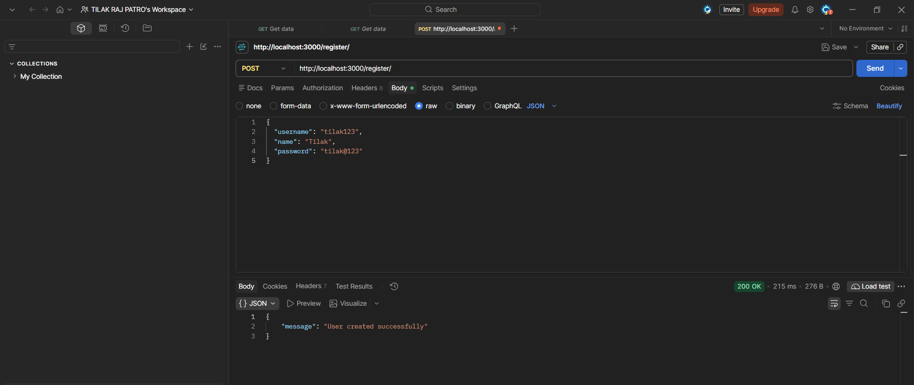
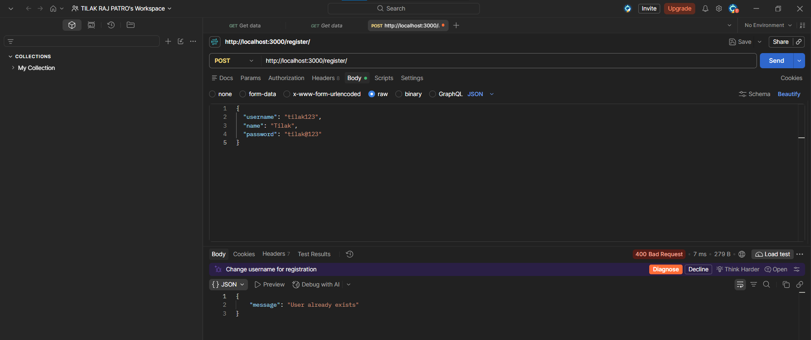
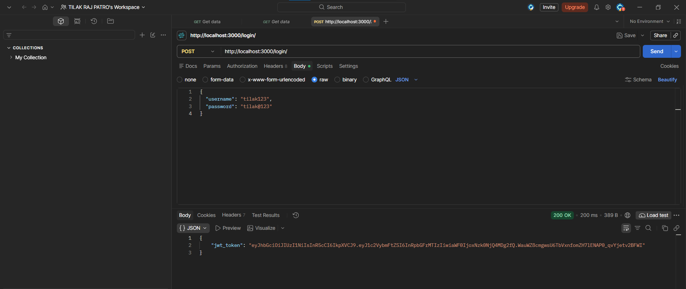
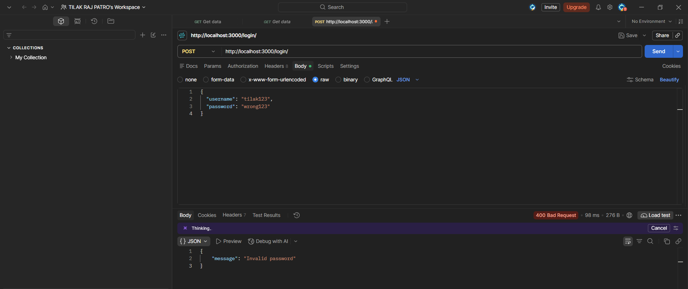
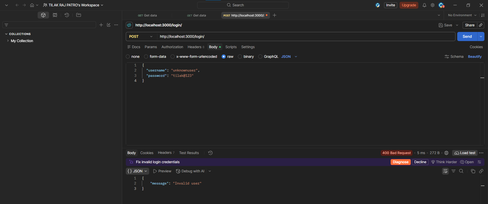
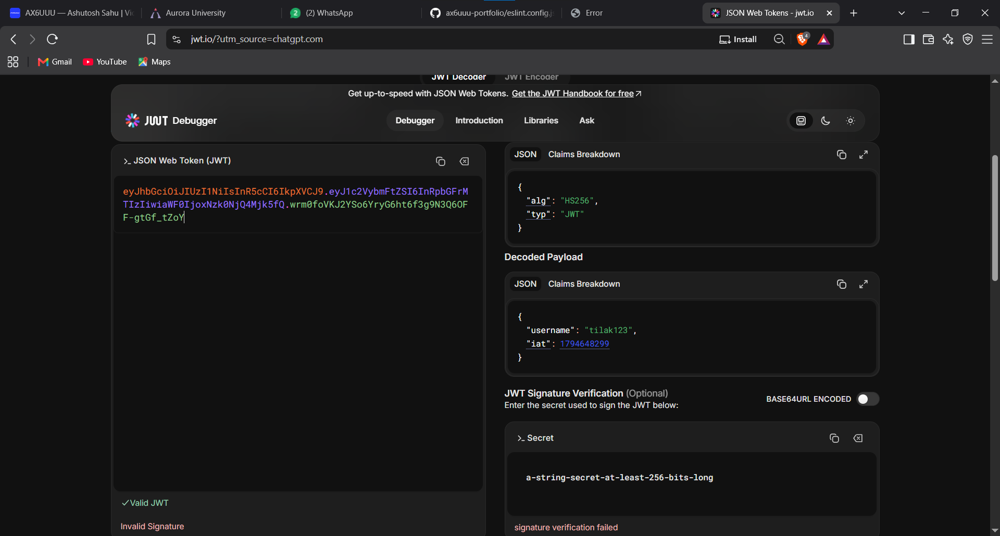

# Lab 4: Registration, Login and JWT

**Name:** Tilak Raj Patro\
**Registration Number:** 252U1R3096\
**Section:** CSE DS-2B

## Live Link

https://backend-development-fundamentals-lab4.onrender.com

## Objective

To implement user registration and login using an SQLite database,
securely hash passwords with bcrypt, and generate JSON Web Tokens (JWT)
after successful login.

## Technologies Used

-   Node.js
-   Express.js
-   SQLite
-   SQLite3
-   bcrypt
-   jsonwebtoken
-   Postman

## How to Run

**1. Clone the repository**

``` bash
git clone https://github.com/rajtilak123/Backend-Development-Fundamentals-Labs.git
```

**2. Navigate to the Lab 4 folder**

``` bash
cd Backend-Development-Fundamentals-Labs/lab-04
```

**3. Install dependencies**

``` bash
npm install
```

**4. Start the server**

``` bash
node app.js
```

The server runs at:

`http://localhost:3000/`

## Environment Variables

The application uses `PORT` if it is provided. Otherwise, it runs on
port `3000` by default.

The JWT secret is currently defined as a constant in `app.js`, as
required for this lab exercise. It should not be shared publicly.


## Database Structure

**Database:** `users.db`

**Table:** `user`

| Column | Data Type | Description |
|---|---|---|
| username | TEXT UNIQUE | Unique username of the user |
| name | TEXT | Name of the user |
| password | TEXT | Hashed password |

Passwords are stored as bcrypt hashes, not as plain text.

## API Endpoints

| Method | Endpoint | Description |
|---|---|---|
| POST | `/register/` | Registers a new user after checking whether the username already exists and hashing the password |
| POST | `/login/` | Checks the username and password, then returns a JWT token after successful login |

## Screenshots

### 1. Successful Registration



### 2. Duplicate User Registration



### 3. Successful Login



### 4. Login with Wrong Password



### 5. Login with Invalid Username



### 6. Decoded JWT



## Notes: Problems Faced and How I Solved Them

1.  I tested the registration API with both new and existing usernames
    to check whether duplicate registration was handled correctly.
2.  I tested the login API with a correct password, an incorrect
    password and an unknown username to verify the error responses.
3.  I used the JWT debugger to decode the generated token and understand
    its header, payload and signature.

## Conclusion

In this lab, I learned how to implement user registration and login
using Express.js and SQLite. I also understood how bcrypt helps store
passwords securely and how JWT is generated after successful
authentication.
